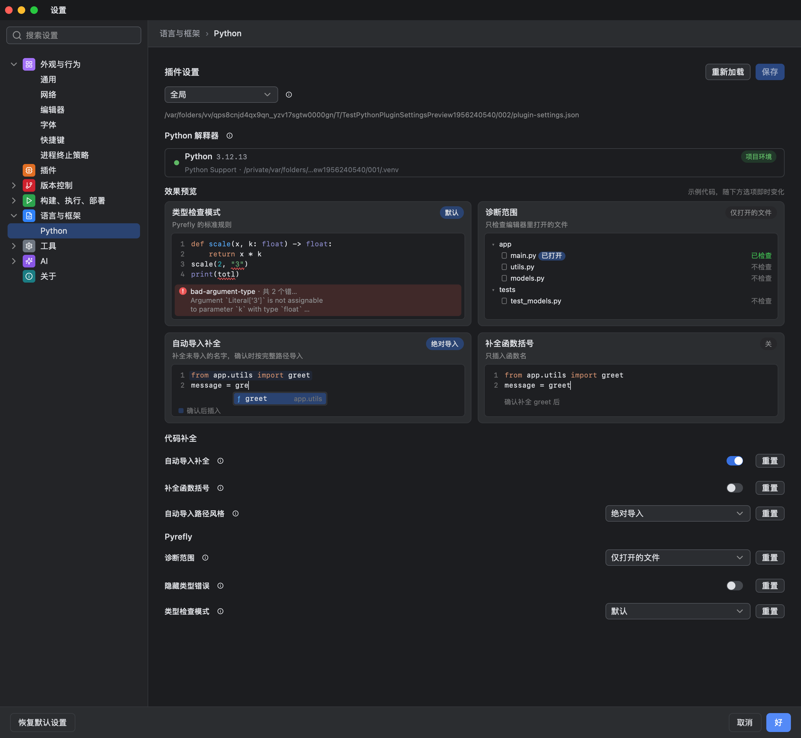
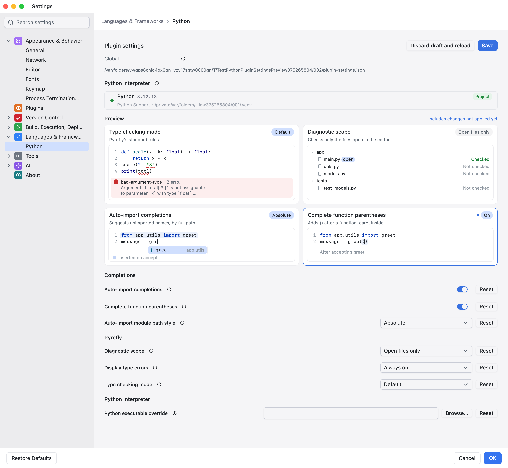
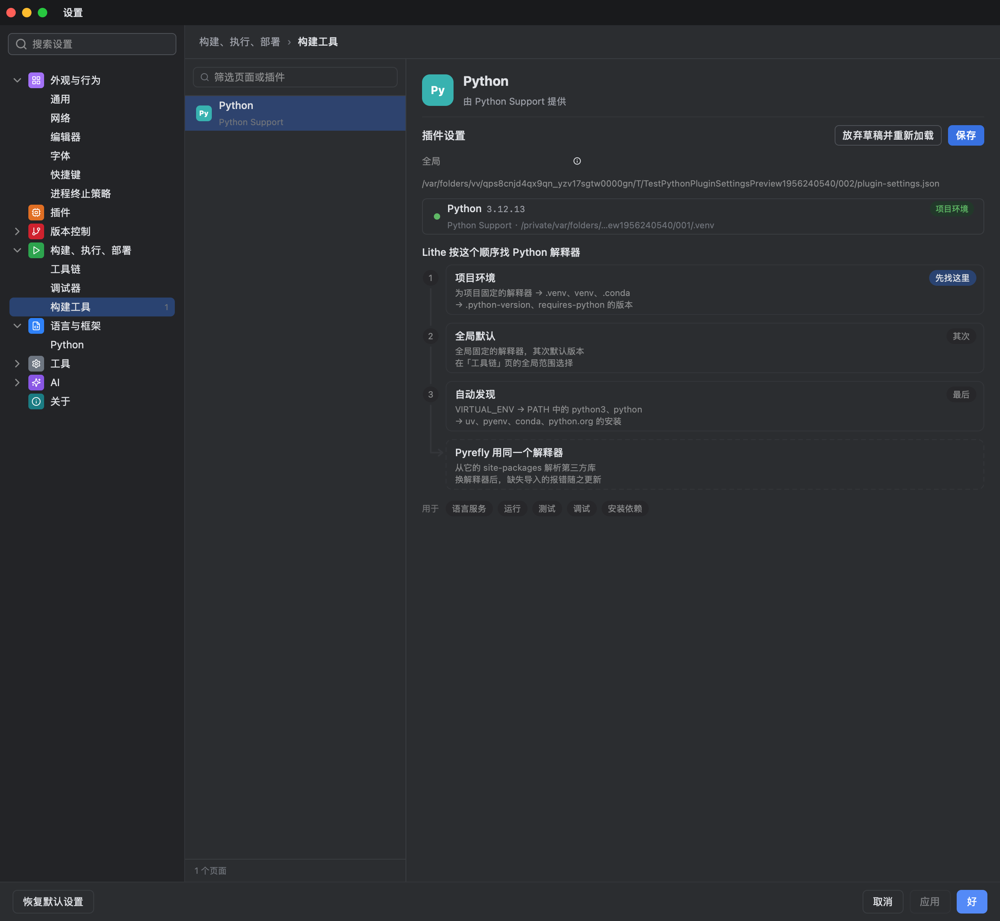

# Python Support for Lithe

为 [Lithe](https://github.com/1lck/Lithe-IDEA) 提供 Python 支持：Pyrefly 代码智能和类型检查；构建窗口里的运行入口、pytest 测试树和已安装包的依赖树；
uv、conda、Ruff、mypy 任务；debugpy 调试；在「新建项目」里创建带 `.venv` 的 Python 项目；设置页画出各项设置的效果和 Lithe 查找解释器的顺序。
这是一个**社区插件**，按插件契约 v0 编写，由 `plugin.json`、几个随包的 Python 脚本、项目模板和一个用 Rust SDK 写的后端组成。
Pyrefly 和 debugpy 随插件包分发，Python 解释器、pytest、uv、conda、Ruff 用你电脑上的。

> English: Python support for Lithe — Pyrefly code intelligence and type checking, run entries, a pytest test tree and
> the installed-package tree in the build window, uv/conda/Ruff/mypy tasks, debugpy debugging, a Python project entry in
> New Project, and previews on the settings pages. Pyrefly and debugpy ship in the plugin; the interpreter, pytest, uv,
> conda and Ruff stay your own. Pick the interpreter from the drop-down at the top of Settings › Languages & Frameworks › Python.

> **兼容性**：1.2.0 需要 0.8.14 之后发布的 Lithe 桌面端（包含 [#2312](https://github.com/1lck/Lithe-IDEA/pull/2312) 和
> [#2316](https://github.com/1lck/Lithe-IDEA/issues/2316) 的版本），旧版本不能安装，请继续用 1.1.0（支持 0.8.9 或更新版本）。
> 各版本的变化见 [docs/releases](docs/releases)。

## 功能

| 功能 | 说明 |
| --- | --- |
| 代码智能 | 补全、自动导入、跳转定义、悬停、类型诊断，由随包的 [Pyrefly](https://github.com/facebook/pyrefly) 1.4.1 提供 |
| 识别文件 | `.py`、`.pyi`、`.pyw`；首行是 Python shebang 的无后缀脚本也按 Python 打开 |
| 运行 | 工具栏「当前文件」运行带 `if __name__ == "__main__"` 的脚本和包里的 `__main__.py`；构建窗口列出 `[project.scripts]`、Django `manage.py`、FastAPI、Flask 等入口；「运行/调试配置 → ＋ → Python」可以手动配置脚本或模块 |
| 测试 | `pytest --collect-only` 收集函数、类方法、参数化用例和 doctest，组成测试树；可以运行整个套件或单个用例 |
| 依赖 | 构建窗口的「依赖」列出所选解释器里已安装的包、版本和依赖关系，不需要 pip |
| 任务 | `pip install -r requirements.txt`、`mypy`；有 `uv.lock` 时 `uv sync`、`uv lock`；有 `environment.yml` 或 `environment.yaml` 时 `conda env update`（两者都有时使用 `environment.yml`）；有 `ruff.toml` 或 `.ruff.toml` 时 `ruff check`、`ruff format`，优先使用项目虚拟环境里的 Ruff |
| 调试 | 随包的 debugpy 1.8.22，支持启动和按地址附加（`host`、`port`、`pathMappings`） |
| 输出链接 | 终端和运行输出里 Traceback 的 `File "…", line N` 可以点击跳到源码 |
| 新建项目 | 选解释器、选是否用 venv 或 uv 建 `.venv`、是否加示例代码；创建后项目固定使用所选解释器 |
| 工具链 | 找到项目的 `.venv`，Poetry、Pipenv、Hatch、virtualenvwrapper 建在项目外的环境，以及电脑上 uv、pyenv、conda、Homebrew、python.org 装的 Python；按 `.python-version` 和 `requires-python` 选版本，见下文“Python 解释器” |
| 设置预览 | 语言页和构建工具页画出设置的效果和解释器的查找顺序，见下文“设置预览” |

## 设置

**插件设置**（「语言与框架 › Python」，也在 设置 → 插件 → Python Support →「设置」），除覆盖路径外都立即生效：

| 设置 | 默认 | 说明 |
| --- | --- | --- |
| 类型检查模式 | 默认 | Pyrefly 的预设：默认、自动、关闭、基础、宽松、严格、全部。项目有 `pyrefly.toml` 或 `[tool.pyrefly]` 时以项目配置为准；“自动”沿用附近的 mypy 或 Pyright 配置，没有时按“基础” |
| 显示类型错误 | 始终开启 | 在哪些文件里显示类型错误：始终开启（没有 Pyrefly 配置的文件按类型检查模式）、仅已配置项目（只在 `pyrefly.toml` 或 `[tool.pyrefly]` 覆盖的文件里）、仅报告缺失导入、关闭（所有文件都不显示，包括有自己 Pyrefly 配置的项目）。Pyrefly 已经没有只报缺失导入的模式，所以“仅报告缺失导入”让没有 Pyrefly 配置的文件按“基础”检查：报告无法解析的导入和少数 Pyrefly 确定的错误。悬停、跳转、补全在各档都照常 |
| 诊断范围 | 仅打开的文件 | 或者“整个工作区”：没打开的文件也报告错误级别的问题 |
| 自动导入补全 | 开 | 补全列出还没导入的名字，确认时插入 `import` |
| 自动导入路径风格 | 绝对导入 | 插入导入时用完整模块路径还是包内相对路径。也用于“移动符号”“转换模块”代码操作；关闭自动导入补全后只有这两个操作用它 |
| 补全函数括号 | 关 | 补全函数或方法时加上 `()`，光标停在括号里 |
| Python 解释器覆盖路径 | 空 | 填一个 Python 可执行文件后，构建任务、运行和 pytest 都用它，不再按下文的顺序查找；Pyrefly 分析和调试仍用查找到的解释器。修改后重新加载项目生效 |

## Python 解释器

Pyrefly 分析代码、运行、测试、调试、读取依赖、安装依赖都用同一个解释器，除非设置了“Python 解释器覆盖路径”：那时构建任务、运行和
pytest 用覆盖路径，Pyrefly 和调试仍用下面找到的解释器。Lithe 按这个顺序找：

1. **项目环境**：为项目固定的解释器；项目里的 `.venv`、`venv`、`.conda`（项目要先被信任）；有 `poetry.lock` 或 `Pipfile` 时，
   Poetry、Pipenv 为这个项目建的环境；项目的 `.python-version` 和 `pyproject.toml` 的 `requires-python` 决定选哪个版本。
2. **全局默认**：全局固定的解释器，其次默认版本。
3. **自动发现**：`VIRTUAL_ENV`，`PATH` 里的 `python3`、`python`，然后是 uv、pyenv、conda、Homebrew、python.org 装的 Python。

`.python-version` 写版本号（如 `3.12`）和 `requires-python` 只选基础解释器，不会选中别的项目的虚拟环境；
`.python-version` 写的是环境名（pyenv-virtualenv 的做法）时，选同名的环境。

换解释器：点「语言与框架 › Python」顶部那一行，在下拉菜单里为项目或全局选一个找到的解释器，或者添加其他目录，
例如建在别处的 `python -m venv`、`uv venv` 环境。菜单底部也能打开 **设置 → 构建、执行、部署 → 工具链**。

## 设置预览

两块预览由插件后端按界面语言、外观和设置窗口宽度画出。它们用示例代码，不读取打开的项目；截图里的路径和版本是测试数据。

**语言与框架 › Python**：顶部是当前用的 Python 解释器，点它打开下拉菜单换解释器；设置了覆盖路径时，下面多一行说明哪些流程改用它。下面四张卡片各对应一项设置：

| 卡片 | 画出什么 |
| --- | --- |
| 类型检查模式 | 示例代码在所选预设下报告哪些错误；示例没有 Pyrefly 配置，“显示类型错误”不是始终开启时，卡片按它画出实际效果 |
| 诊断范围 | 一个小项目里哪些文件会被检查 |
| 自动导入补全 | 补全列出未导入的 `greet`，确认后按绝对或相对路径插入导入；关闭时只补全已导入的名字 |
| 补全函数括号 | 确认补全后是 `greet()` 还是 `greet` |



还没应用的修改先画进预览：改动的卡片换成强调色边框，值前加圆点，右上角标出“含未应用的修改”。下图打开了补全函数括号：



**构建工具 › Python**：顶部同样是解释器下拉菜单；下面先画覆盖路径（有没有设置、设置后谁用它），再画上面三步查找顺序，以及查找到的解释器用在哪些流程。这一页没有其他设置项。



## 依赖的程序

| 程序 | 用途 | 来源 |
| --- | --- | --- |
| Python 3.9 或更新，调试要 3.10 或更新 | 运行、测试、调试、依赖、读取项目 | 你电脑上的，见上文“Python 解释器” |
| pytest | 测试树和运行测试 | 装在项目用的解释器里 |
| mypy | `mypy` 任务 | 装在项目用的解释器里 |
| uv、conda | 对应的任务 | `PATH`。Conda 任务使用 `PATH` 或 Python 工具链中的解释器选择环境文件。 |
| Ruff | Ruff 检查与格式化任务 | 项目的 `.venv`、`venv`、`.conda`，然后是 `PATH` |
| Pyrefly 1.4.1 | 代码智能 | 随插件包 |
| debugpy 1.8.22 | 调试 | 随插件包，由项目用的解释器运行，需要 Python 3.10 或更新 |

安装插件时 Lithe 会列出这些程序和插件需要的权限，确认后才安装。

## 安装

在 **设置 → 插件** 的市场里搜索 Python Support 安装。也可以从 [Releases](https://github.com/Lithe-IDEA/lithe-plugin-python/releases)
下载对应平台的 `python-support-<版本>-<平台>.zip`（`darwin-arm64`、`darwin-x64`、`windows-x64`、`windows-arm64`、`linux-x64`、`linux-arm64`），
在 **设置 → 插件** 里点 **从文件安装…**，核对 SHA-256 和权限后确认。

## 工作方式

- 后端用 [Rust 插件 SDK](https://github.com/Lithe-IDEA/Lithe-core-rust/tree/main/shared/plugins/sdk/rust) 编写，回答
  `pyrefly.resolveLaunch`（启动 Pyrefly 并传入所选解释器）、`settings.view`（两块设置预览）和 `toolchains/query`（读取 conda 登记、uv、pyenv、
  Poetry、Pipenv、Hatch、virtualenvwrapper 环境和项目的版本要求）。后端不保存状态，也不写文件。
- 虚拟环境的 `bin/python` 通常链接到基础安装。`plugin.json` 的 python 工具定义写了 `executableLinksOutsideHome`，
  Lithe 按环境里的路径启动它，Python 因此能找到自己所在的环境和装在里面的包。
- 构建提供者 `scripts/build_provider.py` 由所选解释器以 `python -I -B` 启动，回答 `lithe/build/model`、`test`、`runEntrypoints` 和 `prepareRun`。
  它只用 `ast` 和 `tomllib` 读项目，不执行项目代码。
- 测试树由 `test.discoveryCommand` 运行 `scripts/discover_tests.py` 得到；报告和 pytest 缓存在 Lithe 分配的目录里，用完由 Lithe 清理。
- debugpy 按 `debugAdapters` 的声明由 `scripts/debugpy_adapter.py` 启动；新建项目由 `projectGenerators` 声明，模板在 `templates/python/`。
- 插件目录在运行时保持只读：随包的脚本都以 `-B` 和 `PYTHONDONTWRITEBYTECODE=1` 运行，不写字节码。

## 诊断日志

后端和构建提供者接入 Lithe 的日志协议，每次请求的成败自动记录；设置预览、运行入口探测、环境检查这类频繁的只读请求，成功时不记录。
插件只在真的降级时上报一次 WARN，恢复后再记一次：

| 类别 | 什么时候 |
| --- | --- |
| `invalid_tool_hint` / `tool_hint_restored` | Lithe 传来的解释器不可用，Pyrefly 按自己的规则找环境 / 又可用了 |
| `pyproject_parse_failed` / `pyproject_restored` | `pyproject.toml` 解析失败，构建模型里少了它声明的入口 / 修好了 |

Pyrefly 和 debugpy 的启动结果由 Lithe 记在插件的日志通道。debugpy 自己的日志写在本次会话的插件目录
`plugins/io.github.lithe-idea.python-support/files/debugpy.*.log`。程序和测试的输出只显示在运行、调试和构建窗口里，不进诊断日志。

## 本地打包

需要 Node.js 22+、Rust 1.87+ 和对应的 target（`rustup target add`）。上游的 Pyrefly、debugpy、Tomli、Packaging 按 `vendor-lock.json`
的 SHA-256 下载到 `.cache/`，可以复制到其他工作树复用。

```bash
cargo test --locked --manifest-path backend/Cargo.toml       # 后端单元测试
node scripts/package.mjs --platform darwin-arm64             # 不带 --platform 时打六个平台
node --test --test-timeout=60000 scripts/package/*.test.mjs  # 核对 dist/ 里的每个包
PYTEST_PYTHON=/path/to/python node scripts/test.mjs          # 用真实的 Pyrefly、pytest、debugpy 跑插件流程
```

输出 `dist/python-support-<版本>-<平台>.zip`。`scripts/test.mjs` 需要一个装了 pytest 的解释器：用 `PYTEST_PYTHON` 指定，或装进 `PYTHON`
（默认 `python3`）。`PYTHON` 要是 3.10 或更新，调试流程要用它建的虚拟环境运行 debugpy。`plugin.json` 的格式见 Rust Core 仓库的
[插件契约](https://github.com/Lithe-IDEA/Lithe-core-rust/blob/main/shared/plugins/contract/v1/README.md)和
[构建工具接入指南](https://github.com/Lithe-IDEA/Lithe-core-rust/blob/main/shared/plugins/guides/build-tool-integration.md)。
打包时把 `scripts/package/conda_env_update.py` 嵌入 Conda 任务的命令参数。脚本只在用户执行任务时读取工作目录里的环境文件。

## 宿主端到端测试

`e2e/host/` 里的测试用 Lithe 桌面端自己的测试工具安装真实插件包，操作编辑器、构建窗口、调试和设置页。
`e2e/host/lithe-host.json` 记录测试最后一次通过时的宿主版本，主仓库不读取本仓库。

需要 Node.js 22+、Go、Rust 工具链、`git` 和两个 Python：

- `PATH` 里的 `python3` 要是 3.10 或更新（调试用的 debugpy 需要），并且能用 `--copies` 建虚拟环境。Homebrew（`/opt/homebrew/opt/python@3.x/libexec/bin`）或 python.org 装的都可以；uv 装的独立版本复制出来不能运行，Xcode 自带的是 3.9；
- `PYTEST_PYTHON` 指向装了 pytest 的真实安装，不能是虚拟环境：`RunCurrentFilePinnedInterpreter` 固定它，
  `RunCurrentFilePinnedEnvironment` 另用 `python3` 在项目外建虚拟环境来固定。例如 `uv python install 3.12 --install-dir .artifacts/test-python`，
  再用 `uv pip install --python <它的 python3.12> --break-system-packages pytest`。

```bash
node scripts/package.mjs --platform darwin-arm64
export LITHE_TEST_PYTHON_PLUGIN_ARCHIVE="$PWD/dist/python-support-1.2.0-darwin-arm64.zip"
PYTEST_PYTHON=/path/to/python3.12 node scripts/e2e-host.mjs
# 只跑固定解释器的两个用例
PYTEST_PYTHON=/path/to/python3.12 node scripts/e2e-host.mjs --run '^TestPythonSupportPluginRunCurrentFilePinned'
```

插件包路径要写绝对路径。脚本把宿主检出到 `.artifacts/lithe-host`，复制 `e2e/host/desktop/` 下的测试后运行；`--source`、`--ref`、`--run`
分别换宿主来源、换宿主版本、只跑部分测试。升级 `revision` 时可能要同步修改测试。

## 功能矩阵

各项能力在各平台上的实现与验收状态见 [docs/feature-matrix.md](docs/feature-matrix.md)，改动插件行为时在同一个 PR 里更新它。

## 发布新版本

1. 修改 `io.github.lithe-idea.python-support/plugin.json` 的 `version`：修复升修订号，加功能升次版本号，特别大的革新才升主版本号。
   依赖还没发布的宿主能力时照样升次版本号，作为预发布版本发布。写好 `docs/releases/v<版本>.md`，合入 `main`。
2. 推送同名标签，例如 `git tag v1.2.0 && git push origin v1.2.0`。
3. `Release` 工作流核对标签与版本，打六个平台的包并发布 Release，说明里附 SHA-256 和 `docs/releases/v<版本>.md`。 正式发布还会对照 Lithe Store 的上一个同平台版本生成可选增量包。校验成功、且补丁最多为完整包的 75% 时才随 Release 发布。
   `release.yml` 的 `PRERELEASE_TAGS` 里的版本标为预发布，目前是 `v0.1.0`、`v0.1.1` 和 `v1.2.0`。
4. Lithe Store 的自动追踪会为稳定版本开合并请求，合并后用户即可更新。

## 许可

插件本身采用 [Apache-2.0](LICENSE)。随包分发的 Pyrefly 1.4.1、debugpy 1.8.22、Tomli 2.5.0（MIT）和 Packaging 25.0（Apache-2.0 或 BSD-2-Clause）
的声明见 [THIRD-PARTY-NOTICES.txt](io.github.lithe-idea.python-support/THIRD-PARTY-NOTICES.txt) 和包内 `vendor/debugpy/ThirdPartyNotices.txt`；
Rust 后端依赖的许可证随包附在 `RUST-THIRD-PARTY-NOTICES.txt`。
